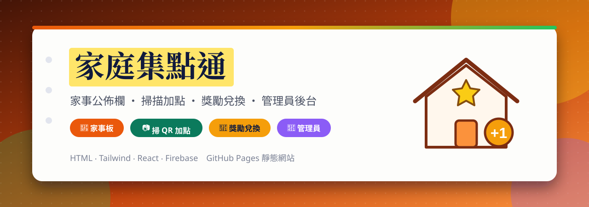
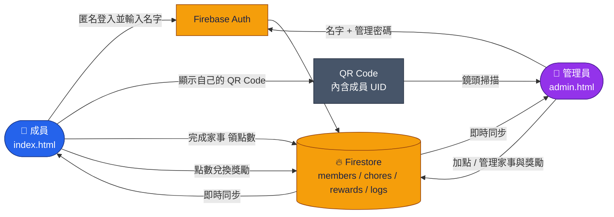

<a id="top"></a>

<div align="center">



<br>

[](https://github.com/Jiachang1112/gathering-point)
[](https://github.com/Jiachang1112)
[](https://jiachang1112.github.io/gathering-point/)

[](https://react.dev/)
[](https://tailwindcss.com/)
[](https://firebase.google.com/)
[](https://firebase.google.com/docs/auth)
[](https://firebase.google.com/docs/firestore)
[](https://pages.github.com/)

**家庭成員掃 QR Code 集點 ‧ 家事任務賺點數 ‧ 點數兌換獎勵 ‧ 成員版／管理員版兩個網頁**

<br>

[](#-特色)
[](#-使用方式)
[](#-firebase-設定)
[](#-注意事項)
[](#-常見問題)

</div>

---

這是一個給家庭用的「點數獎勵」網頁：小朋友（成員）完成家事就能賺點數，點數累積後兌換爸媽設定的獎勵；爸媽（管理員）用另一個網頁管理成員、家事與獎勵，還能掃描成員的 QR Code 直接加點。

<div align="center">

[](https://jiachang1112.github.io/gathering-point/)
[](https://jiachang1112.github.io/gathering-point/admin.html)

</div>

## ✨ 特色

<table>
<tr>
<td width="33%" valign="top">

### 👦 成員版
輸入名字就加入，首頁顯示自己的點數與專屬 **QR Code**，也能看家事清單與可兌換的獎勵。

</td>
<td width="33%" valign="top">

### 👑 管理員版
以管理密碼進入，可以看到所有成員、掃描 QR Code 加點、管理家事與獎勵。

</td>
<td width="33%" valign="top">

### 🧹 家事任務
管理員建立家事與點數，成員完成後領取點數，並留下紀錄。

</td>
</tr>
<tr>
<td width="33%" valign="top">

### 🎁 獎勵兌換
點數夠就能兌換獎勵，兌換前會先跳出確認視窗，扣點與紀錄一次完成。

</td>
<td width="33%" valign="top">

### 📜 歷史紀錄
每次加點與兌換都會寫進紀錄，可以回頭查看。

</td>
<td width="33%" valign="top">

### ⚡ 即時同步
資料存在 Firestore，多台裝置之間即時更新，不用重新整理。

</td>
</tr>
</table>

---

## 🧩 運作方式



### 📁 檔案說明

```text
gathering-point/
├── index.html    成員版：加入、QR Code、家事、獎勵兌換、歷史紀錄
├── admin.html    管理員版：成員總覽、掃描加點、家事管理、獎勵管理
└── assets/readme/readme-banner.svg
```

沒有建置步驟，兩個檔案都是單頁網頁（React、Tailwind 與 Firebase 皆由 CDN 載入）。

---

## 📖 使用方式

1. 管理員先開啟 [管理員版](https://jiachang1112.github.io/gathering-point/admin.html)，輸入稱呼與管理密碼，建立管理員帳號。
2. 在「家事管理」新增家事與點數，在「獎勵管理」新增獎勵與所需點數。
3. 成員開啟 [成員版](https://jiachang1112.github.io/gathering-point/)，輸入名字加入，首頁會出現自己的 **QR Code**。
4. 完成家事後，成員在「家事」頁領取點數；或讓管理員在「掃描加點」頁掃描 QR Code 直接加點。
5. 點數夠了，到「獎勵」頁兌換，管理員可在紀錄中看到兌換內容。

---

## 🔥 Firebase 設定

網頁使用 [Firebase](https://console.firebase.google.com/) 的 **匿名登入** 與 **Firestore**：

1. 建立 Firebase 專案，開啟 **Authentication → 登入方式 → 匿名**。
2. 建立 **Firestore Database**，並設定安全規則（見下方注意事項）。
3. 把專案的 Web 設定填進 `index.html` 與 `admin.html` 中的 Firebase 設定。
4. 資料會存放在 `artifacts/<appId>/` 之下：`public/data/members`、`chores`、`rewards`、`logs`，以及每位使用者自己的 `profile/info`。

啟用 GitHub Pages：倉庫 **Settings → Pages → Deploy from a branch → main / (root)**。

---

## ⚠️ 注意事項

- **管理密碼是在瀏覽器裡比對的**，任何人都能從網頁原始碼看到，只能擋一般使用者，不是真正的安全機制。要真的保護資料，請用 **Firestore 安全規則** 限制誰能改點數、家事與獎勵（例如只允許特定管理員 UID 寫入）。
- 匿名登入的 UID 綁在瀏覽器上，換瀏覽器或清除資料就會變成新成員。
- Firebase 的 Web 設定本來就會出現在前端，沒有問題；真正的防護來自安全規則。
- 掃描 QR Code 需要允許瀏覽器使用相機，且網頁必須是 HTTPS（GitHub Pages 符合）。

---

## ❓ 常見問題

<details>
<summary><b>畫面出現「權限不足」</b></summary>

代表 Firestore 的安全規則拒絕了讀寫，請調整規則並確認匿名登入已啟用。

</details>

<details>
<summary><b>成員的點數不見了</b></summary>

點數綁定匿名帳號；換了瀏覽器或清除網站資料就是新帳號，需要管理員重新加點。

</details>

<details>
<summary><b>掃描不到 QR Code</b></summary>

確認已允許相機權限、光線足夠，並讓 QR Code 完整出現在畫面中。

</details>

<details>
<summary><b>可以給很多家庭一起用嗎</b></summary>

資料放在同一個 `appId` 底下，同一組 Firebase 設定的人會共用資料；不同家庭請各自建立 Firebase 專案。

</details>

---

<div align="center">

[GitHub @Jiachang1112](https://github.com/Jiachang1112)　‧　[gathering-point](https://github.com/Jiachang1112/gathering-point)

[](#top)

</div>
